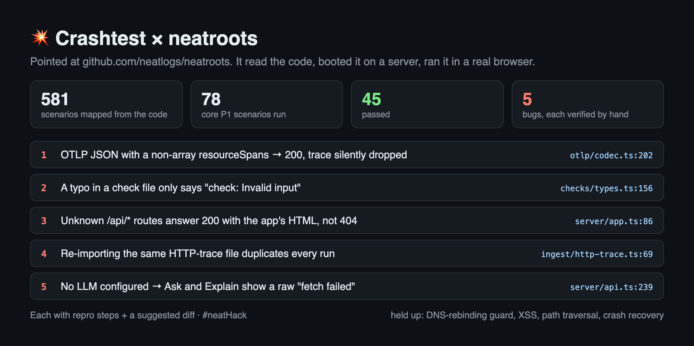

# Crashtest

**Find the bugs your users would hit, before they hit them.**

Most bugs that reach users are not in code nobody tested. They are in paths nobody walked: rejecting instead of approving, the empty account, the second tab, someone else's id in the URL. Crashtest is a macOS app with an autonomous agent that walks those paths for you.

Give it a GitHub repo and it:

1. **Maps the app from its code** — screens, actions, API operations, background jobs, integrations, roles, entity lifecycles, limits.
2. **Writes every scenario a user can do or live through**, ranked P1–P3 and grouped by user journey.
3. **Runs them for real** — clones the app, boots it on your Mac or on your own server (VDS), drives it in a browser, and reports what broke with a screenshot, the root cause at `file:line`, and a suggested diff. It never edits your code.

Built during [neatHack](https://neatlogs.com/hackathon) (Oct 10–12, 2026). Build log: [hackathon.md](hackathon.md).

> 🎬 **Demo (2:39):** [docs/demo.mp4](docs/demo.mp4) · **Live page:** [Crashtest's full neatroots run](http://34.238.91.131:8080) — every dot is one scenario, 581 of 581 done.

## neatlogs asked us to test their own product

After our first post, neatlogs' head of product engineering [replied](https://x.com/kurokotetsuyami/status/2108943094809071674): *"run this on neatroots, & share your findings with me"*. So we did. Crashtest mapped [neatlogs/neatroots](https://github.com/neatlogs/neatroots) into **581 scenarios across 12 user journeys** in under 5 minutes, booted it on a 2 GB server by itself, and ran **every one of them: ✅ 316 · ❌ 158 · ⏭ 107**. We checked the broken verdicts by hand against the source: **21 real bugs**, among them turning steering off still letting a halt note stop the agent, one bad regex in a check freezing the whole server for 33 seconds, `retention.days: 0` in `config.yaml` deleting every run on start, and a large import upload crashing the server. Each one has repro steps, `file:line` and a fix: [docs/evidence/findings-neatroots.md](docs/evidence/findings-neatroots.md).

**neatlogs fixed them.** Within hours of the report, the neatroots team merged fixes for the first ten ([#1](https://github.com/neatlogs/neatroots/pull/1)–[#10](https://github.com/neatlogs/neatroots/pull/10)) and shipped more in v0.2.8 ([#15](https://github.com/neatlogs/neatroots/pull/15)); [PR #40](https://github.com/neatlogs/neatroots/pull/40) by their head of product engineering fixes the rest and closes [our issue](https://github.com/neatlogs/neatroots/issues/23). All 21 findings fixed or in review.



## What it found on its first real target

On [TonyMckes/conduit-realworld-example-app](https://github.com/TonyMckes/conduit-realworld-example-app), a well-known RealWorld implementation, Crashtest mapped 39 surfaces into **294 scenarios** across 9 journeys in 143 s, booted the app from scratch (local Postgres, generated `.env`, API + frontend) and ran **every one of them**:

**✅ 180 passed · ❌ 104 broken · ⏭ 10 skipped** — and the 104 broken scenarios trace back to **34 files**. Among them:

- **Saving your settings with a blank password replaces your password.** `backend/controllers/user.js:36` checks `password !== undefined || password !== ""`, which is always true.
- **Any bad, forged or expired token crashes the request with a 500** instead of a 401 — 14 scenarios, one error path in `backend/middleware/authentication.js`.
- **Tokens never expire and survive logout and password changes** (`backend/helper/jwt.js`).
- **A comment can be deleted through any article's URL** — `backend/controllers/comments.js` ignores the slug. Found on the first run and found again, independently, in the full run.
- **Duplicate usernames, self-follows, double-click double-publishes**, negative `limit`/`offset` → 500 with raw DB errors.

We checked the top findings against the source by hand. Details, diffs and screenshots: [docs/evidence/findings-conduit.md](docs/evidence/findings-conduit.md).

It is not tied to one app: on [thedevs-network/kutt](https://github.com/thedevs-network/kutt) (URL shortener) the same build mapped 50 surfaces into **359 scenarios across 11 journeys** in 144 s, then ran all 141 P1 scenarios: **✅ 97 · ❌ 31 · ⏭ 13**. Worst one: deleting a domain "without its links" deletes every link on it, because the checkbox sanitizer passes the string `"false"` through as truthy. [docs/evidence/findings-kutt.md](docs/evidence/findings-kutt.md).

## How it works

```
GitHub link ─► Intake ─► Inventory agent ─► Scenario writer ─► [Start] ─► Local │ VDS
               clone,     Sonnet 5.5,        Haiku 5.5,                     │
               products   read-only tools    parallel per journey           ▼
                                                              Bootstrap agent ─► Sweep agent
                                                              boots the app      one scenario at a time,
                                                              (shell, logs,      Playwright browser + API,
                                                              ports, recovery)   verdict + root cause + diff
```

- **Agents** run on the [Claude Agent SDK](https://docs.claude.com/en/api/agent-sdk/overview) with a per-phase tool set: the inventory agent can only read; the bootstrap and sweep agents operate the app through Crashtest's own MCP tools (`shell`, `start_background`, `read_log`, `expose_port`, `http_get`).
- **Local and VDS are the same to the agent.** Both runtimes implement those tools; the VDS runtime works over SSH and tunnels the app's ports back so the browser on your Mac can drive it.
- **Recovery.** If the app stops answering mid-run, Crashtest restarts it with the commands the bootstrap agent used and carries on. Services run in the foreground and are always stopped at the end, even if you quit mid-run.
- **Chat.** Ask about the app, hand over `.env` values or server details (stored encrypted in the macOS Keychain), or start a run from the conversation.

## Built with the neatHack tools

| Tool | How Crashtest uses it |
|---|---|
| [neatlogs](https://neatlogs.com) | Every phase is its own traced workflow (`repo-inventory`, `scenario-generation`, `app-bootstrap`, `scenario-sweep`, `app-recovery`, `project-chat`), grouped per project. Four custom detections in a "Crashtest agent" group — **Bug found by Crashtest** (108), **Auth or account bug found** (57), **Server error in app under test** (39) and **Unverified verdict** (21) — and before/after traces drove real fixes. Our own build sessions are traced too. [Evidence](docs/evidence/neatlogs-baselines.md) |
| [Entire](https://entire.io) | Checkpoints on our commits ([repo on Entire](https://entire.io/gh/emreozyoruk/crashtest), first checkpoint [`97c75579b386`](https://entire.io/gh/emreozyoruk/crashtest/commit/74641efd901999e96d69fd85f69dde70f3aa0a62)), plus **Entire Graph inside the product**: the inventory and sweep agents get graph search / definitions / callers / blast-radius tools over the repo under test. [Evidence](docs/entire/README.md) |
| [cfo.ai](https://cfo.ai) | [Business plan for Crashtest](https://app.cfo.ai/s/--rWFPOxuMvaL0nN) (read-only link; [Upside](https://app.cfo.ai/s/C9DgOonrAXn3DhqQ), [Downside](https://app.cfo.ai/s/e_GPD5Z-hJGywRX7)): Pro $29 / Cloud $299 pricing, unit costs taken from our neatlogs traces ($0.117 per scenario run, $0.815 per repo inventory), customers → revenue → P&L → cash, and three scenarios. Finding: the first engineer hire decides the runway. [Evidence](docs/cfoai/README.md) |

## Run it

Requirements: macOS, Node 22+, git. Optional: the [Entire CLI](https://entire.io) for graph tools.

```bash
npm install
npm run dev
```

Open **Settings**, add your Anthropic API key (and a GitHub token for private repos, or SSH details for a VDS), then paste a GitHub link into the chat.

## License

MIT
