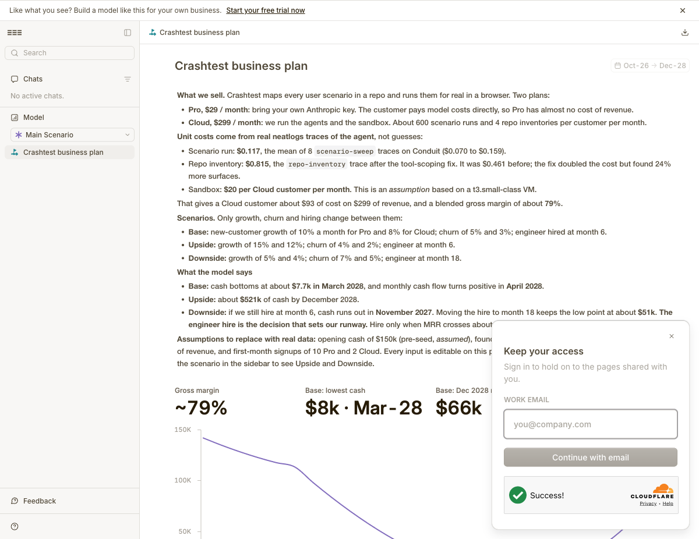

# cfo.ai evidence

The Crashtest business plan is a live model in cfo.ai, built through the cfo.ai MCP server
from this repo's Claude Code session.

- Base scenario: https://app.cfo.ai/s/--rWFPOxuMvaL0nN
- Upside: https://app.cfo.ai/s/C9DgOonrAXn3DhqQ
- Downside: https://app.cfo.ai/s/e_GPD5Z-hJGywRX7

## How the model is built

| Table | What it holds |
|---|---|
| Plan assumptions | Per plan (Pro, Cloud): price, first-month signups, monthly new-customer growth, monthly churn |
| Unit costs and operating inputs | Cost per scenario run, cost per repo inventory, runs and repos per Cloud customer, sandbox cost, pay, hire month, tools, marketing share, opening cash |
| Customers and revenue | Monthly, by plan: new customers → paying customers (churned) → revenue |
| P&L and cash | Revenue, cost of revenue, gross profit and margin, payroll, marketing, tools, operating expenses, net cash flow, cash balance, runway in months |

Every output is a formula over those inputs, so changing one input recomputes the whole plan.
Upside and Downside are cfo.ai scenarios that override only growth, churn and the hire month.

## Where the unit costs come from

Not guesses: they are neatlogs measurements of Crashtest's own agents
([docs/evidence/neatlogs-baselines.md](../evidence/neatlogs-baselines.md)).

| Input | Value | Source |
|---|---|---|
| Cost per scenario run | $0.117 | Mean of 8 `scenario-sweep` traces on Conduit ($0.070–$0.159) |
| Cost per repo inventory | $0.815 | `repo-inventory` trace `ba2cc6ee…` after the tool-scoping fix |
| Sandbox per Cloud customer | $20 / month | Assumption: t3.small-class VM, the size our VDS test used |

## Results (Oct 2026 – Dec 2028)

| Scenario | Lowest cash | Cash in Dec 2028 | Note |
|---|---|---|---|
| Base | $7.7k (Mar 2028) | $122k | Cash flow positive from Apr 2028 |
| Upside | $47k (Nov 2027) | $521k | |
| Downside, hire at month 6 | runs out in Nov 2027 | — | |
| Downside, hire at month 18 | $51k (Dec 2028) | $51k | The fix the plan recommends |

Gross margin is about 79%. Opening cash ($150k), pay and marketing share are disclosed
assumptions, labelled as such in the model.
