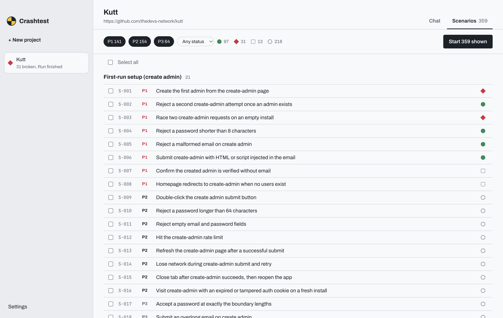

# Crashtest findings — thedevs-network/kutt

A second, unrelated app, to show Crashtest is not tuned to one repo. Kutt is a URL shortener
(Node/Express, Knex, SQLite by default) with accounts, custom domains, password-protected and
expiring links, stats and an admin area.

**Analysis:** 50 surfaces across 11 journeys → **359 scenarios** (141 P1 · 154 P2 · 64 P3) in 144 s.

**Every P1 scenario, one local run (2026-10-10 03:48–05:33 PDT):** the bootstrap agent created
`.env` with a generated `JWT_SECRET`, ran the 10 SQLite migrations and started the dev server.

**✅ 97 passed · ❌ 31 broken · ⏭ 13 skipped — tracing back to 15 files.**

## Highlights

| Finding | Where | Checked by hand |
|---|---|---|
| **Deleting a domain "without its links" deletes all its links.** `sanitizeCheckbox` returns the string `"false"` unchanged, and `if (links)` treats it as true. | `server/handlers/validators.handler.js:18`, `server/handlers/domains.handler.js:97` | ✅ real |
| **Two concurrent `create-admin` requests on a fresh install create two ADMIN accounts** — check-then-insert with no lock. | `server/handlers/auth.handler.js:116-130` | from the trace |
| **Expired links keep redirecting** until a 30 s cron deletes them, or up to 15 min with the Redis cache — the redirect handler never compares `expire_in` with now. | `server/handlers/links.handler.js:459-544`, `server/cron.js` | ✅ real, see note |
| `data:` and `javascript:` targets accepted; banned-domain check misses subdomains | `server/handlers/validators.handler.js` | from the trace |
| Another user's link: PATCH / DELETE / stats return 500 instead of 404 | `server/handlers/links.handler.js` | from the trace |
| No rate limit on protected-link passwords, reports, password reset unless `ENABLE_RATE_LIMIT` is set | `server/routes/link.routes.js`, `server/env.js` | from the trace |

**Note on honesty.** The first verdict on expired links said kutt had no expiry enforcement. That
overstated it: kutt has a cron job. We changed the runner's rules (look for the job behind any
time-based behavior and report a delay as a delay) and re-ran the scenario; the new verdict cites
`server/cron.js` and gives the real window.

Every finding with root cause and suggested diff: [findings-kutt-p1.md](findings-kutt-p1.md).
